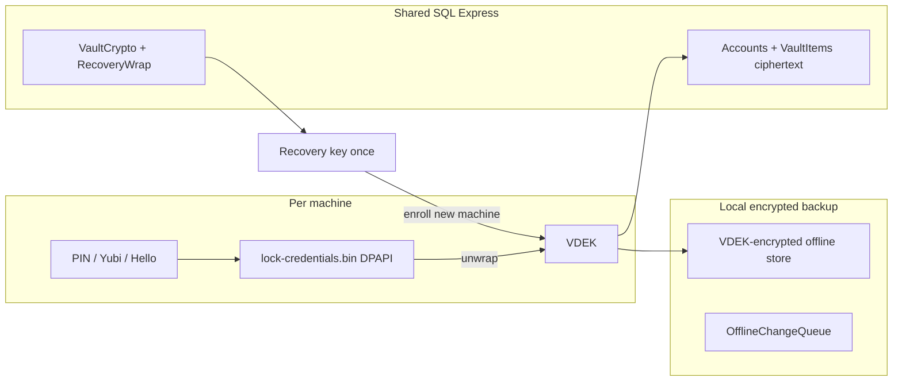
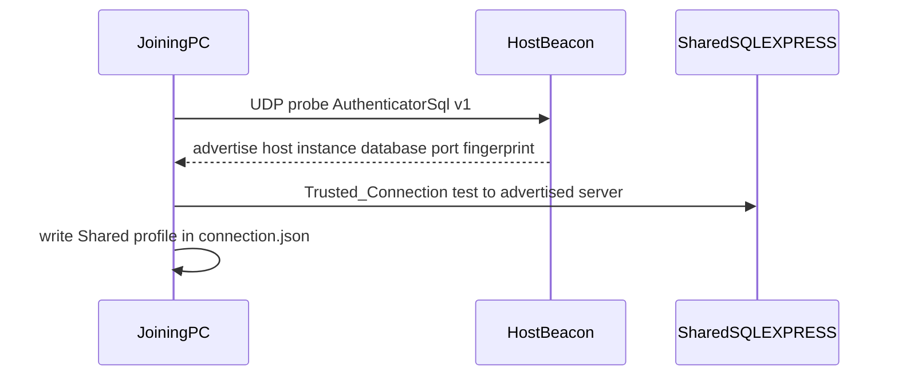

# Shared SQL Vault + Full Password Management

## Product rule change

Update [`docs/phases/README.md`](docs/phases/README.md) and [`.cursor/rules/phase-handoffs.mdc`](.cursor/rules/phase-handoffs.mdc): drop “no password vault”; add **Phase G — Shared Vault**. Keep one-chat-per-slice discipline. Phase D stays historically removed; new work is **G**, not resurrecting D.

---

## Concrete crypto model (shared store + per-machine unlock)

**Problem:** Today’s DEK in [`Authenticator.Crypto`](Authenticator.Crypto) is machine-local via `%LocalAppData%\Authenticator\lock-credentials.bin`. Field ciphertext (`v1:` AES-GCM) is useless on another PC.

**Solution: promote one shared Vault DEK (VDEK)** — same 32-byte key every machine uses; existing unlock methods wrap that VDEK.



| Piece | Behavior |
|-------|----------|
| **VDEK** | One vault-wide DEK. Field secrets (TOTP, passwords, cards, notes) stay `SecretProtector` `v1:` under this key. |
| **Machine unlock** | Unchanged UX: PIN / Yubi / Hello unwrap VDEK into `VaultKeyService` from local `lock-credentials.bin`. |
| **Migration** | **Promote the existing local DEK to VDEK** — no bulk re-encrypt of current `Account.SecretKey` / `BackupCode.Code`. |
| **Shared SQL `VaultCrypto`** | Row with `CryptoFormatVersion`, `VdekFingerprint` (SHA-256 of VDEK), `RecoveryWrap` (VDEK wrapped under recovery key KEK). |
| **New-machine enrollment** | Discover/connect to shared Express → enter recovery key (or import one-time enrollment file) → unwrap VDEK → enroll local PIN/Yubi/Hello wraps into `lock-credentials.bin`. |
| **WealthForge** | [`AuthenticatorUnlock`](D:\Source\WealthForge\WealthForge.Desktop\Helpers\AuthenticatorUnlock.cs) already unlocks via the same store → gets VDEK → can decrypt shared TOTP with no second master password. |
| **Local encrypted backup** | Same VDEK encrypts the offline store (file-based by default so Join PCs need no Express); offline unlock uses the same unlock methods. |

No second master password. Recovery key is shown once at first shared-vault creation / migration and stored only as a wrap in SQL (plus user printout).

---

## SQL Express stays (engine + install roles)

**SQL Server Express remains the shared system of record.** Do not switch the shared store to SQLite/LocalDB. Synology or a dedicated PC can host Express; the product no longer assumes every machine installs Express.

Today [`packaging/Authenticator.iss`](packaging/Authenticator.iss) always prefers/installs local `.\SQLEXPRESS` and writes `connection.json`. That becomes **role-aware**:

| Role | When | Installer behavior |
|------|------|--------------------|
| **Host (first on network)** | User chooses “Host shared vault on this PC” (or no discovery hits) | Offer to **install/configure SQL Express** (`SQLEXPRESS`) as the shared instance; enable TCP/IP + Windows Firewall for the instance; create DB `Authenticator`; write Shared profile to `HOSTNAME\SQLEXPRESS`; start discovery advertisement |
| **Join (subsequent)** | Discovery finds an existing Authenticator shared instance | **Skip SQL Express install**; write Shared profile from discovery (or manual override); enroll VDEK via recovery key after first unlock setup |
| **Offline-only / legacy local** | Optional advanced | Keep or install local Express only if user explicitly wants a local SoR profile (dev / single-PC) |

Settings can change role later (promote a machine to host, or re-point at another discovered host).

---

## LAN discovery (no hard-coded server names)

**Goal:** Other machines locate the shared Express instance without baking `SYNOLOGY\…` or a hostname into the installer.

**Chosen mechanism: Authenticator discovery beacon (UDP) + optional SQL Browser assist.**



**Host side (runs while Authenticator is unlocked, or via a tiny always-on helper if we need advertise-when-app-closed):**
- Listen on a fixed UDP port (e.g. `38455`) for probes tagged `AuthenticatorSql/1`.
- Reply with JSON: `{ "product":"Authenticator", "version":1, "server":"HOST\\SQLEXPRESS", "database":"Authenticator", "port":1433, "vdekFingerprintPrefix":"…" }`.
- Also register a Windows Firewall inbound rule for that UDP port during host setup.
- Optional assist: ensure SQL Browser (`UDP 1434`) is running so `HOST\SQLEXPRESS` resolves; beacon carries the canonical `server` string so clients do not scrape Browser alone.

**Join side (installer + Settings + first-run):**
- Broadcast/multicast probe on the LAN; collect replies for ~2–3s; show a picker of discovered hosts.
- Verify TCP connect + open `Authenticator` DB before accepting.
- Allow **manual server entry** if discovery fails (VPN, AP isolation, firewall).
- Persist chosen server in `connection.json` (discovery is for selection, not a runtime dependency every launch — though Settings keeps a “Find shared instance…” action).

**Security notes:** Beacon reveals hostname/instance only on the LAN; it does **not** send the VDEK or recovery key. Joining still requires Windows auth to SQL plus vault recovery/enrollment. Fingerprint prefix helps the UI warn if the discovered vault does not match a previously enrolled fingerprint.

WealthForge can reuse the same probe/advertise protocol later; document it in `docs/phases/G.md`.

---

## Connection target selection (G1)

WealthForge has **no** picker yet ([`architecture_roadmap.md`](D:\Source\WealthForge\architecture_roadmap.md) backlog; hardcoded `.\ZOGEXPRESS2025`). Implement here first in a **sharable JSON shape** WealthForge can mirror later.

Extend [`ConnectionConfig.cs`](Authenticator.Wpf/Data/ConnectionConfig.cs) / `connection.json`:

```json
{
  "activeProfile": "Shared",
  "role": "Join",
  "profiles": [
    { "name": "Local", "server": ".\\SQLEXPRESS", "database": "Authenticator" },
    { "name": "Shared", "server": "DESKTOP-HOST\\SQLEXPRESS", "database": "Authenticator", "discovered": true }
  ],
  "discovery": { "udpPort": 38455, "lastFingerprintPrefix": "a1b2…" }
}
```

- Settings UI: profile list, **Discover on LAN**, add/edit (server + database), Test connection, Set active, Host vs Join helpers, show current effective server.
- Still `Trusted_Connection=True` (Windows auth to the shared Express host).
- On startup: try active Shared profile; if unreachable → open **local encrypted offline backup** and set offline banner.
- Document the JSON + discovery protocol in `docs/phases/G.md` for WealthForge copy.

---

## Schema (same `Authenticator` DB on shared SQL Express)

Keep DB name **`Authenticator`** on the shared Express instance (WealthForge already points at it). Add vault tables beside existing 2FA tables.

**2FA (mostly unchanged):** `Accounts` (incl. `IsFavorite`), `Folders`, `BackupCodes`.

**New crypto / sync:**

- `VaultCrypto` — fingerprint + recovery wrap
- `OfflineChangeQueue` — queued mutations while offline (entity type, id, op, payload hash, UTC)
- `ExternalLinks` — per item: `Provider` (string/enum covering every PasswordManager backend + `Shared`), `ExternalId`, `LastSyncedAt`, `ContentHash`, `IsMismatch`. An item may have links to multiple providers.

**Vault items — hybrid polymorphic (chosen default):**

- `VaultFolders` — org across item types (can later unify with 2FA folders via `FolderScope`)
- `VaultItems`:
  - `Id` (Guid), `ItemType` discriminator, `Title`, `FolderId`, `Notes` (encrypted if sensitive), `IsFavorite`, `IsDeleted`, timestamps
  - Common login columns: `Username`, `Password` (encrypted), `Url`, `LinkedAccountId` (FK → `Accounts`), optional `TotpSecret` (encrypted) for LastPass-imported inline TOTP
  - `PayloadJson` (encrypted) for type-specific structured fields (card number/exp/CVV, address lines, bank routing/account, etc.)
- `VaultCustomFields` — `ItemId`, `Name`, `Value` (encrypted), `IsSecret`, sort order

**ItemType enum aligned to LastPass:** `Login`, `SecureNote`, `CreditCard`, `Address`, `BankAccount`, `Server`, `EmailAccount`, `Database`, `InstantMessenger`, `SshKey`, `Wifi`, `Membership`, `Passport`, `DriverLicense`, `Insurance`, `HealthInsurance`, `Other`.

Replace unused stub [`PasswordEntry.cs`](Authenticator.Wpf/Data/Models/PasswordEntry.cs) with this model (migrate any dead CRUD in `DatabaseService`).

**TOTP link rule:** Prefer `LinkedAccountId` to an Authenticator `Account`. Keep optional `TotpSecret` on login items for LastPass import parity; UI can “Promote to 2FA account” later.

**Local encrypted offline backup (clients without Express):** Join-role machines skip Express, so offline storage is **not** a second SQL Express DB by default. Use a VDEK-encrypted local backup under `%LocalAppData%\Authenticator\` (SQLite or encrypted snapshot with the same logical schema + `OfflineChangeQueue`). Host machines may keep a local Express copy as well, but the portable path is the file-based encrypted backup so every Join install works offline. Secrets remain `v1:` under the shared VDEK — same unlock methods.

---

## UI shell (G4)

[`MainWindow.xaml`](Authenticator.Wpf/MainWindow.xaml) today: bottom nav Codes / Backup / Settings.

Target:

```
┌─────────────────────────────────────┐
│  [ 2FA Codes ]  [ Vault ]           │  top tabs
│  (offline badge when on replica)    │
├─────────────────────────────────────┤
│  page host                          │
├─────────────────────────────────────┤
│  contextual bottom bar              │
│  2FA: Codes | Backup | Favorites |… │
│  Vault: All | Favorites | Add | …   │
│  global: Settings + Lock + dock     │
└─────────────────────────────────────┘
```

- Preserve lock overlay, auto-lock, dock-to-edge, tray.
- Favorites: bottom action + filter that unions favorited `Accounts` and `VaultItems`.
- **No MVVM.** All new UI (Vault, Diff/match, generator, connection/discovery, Settings additions) stays WPF **code-behind** like `CodesView` / `MainWindow` today — no ViewModels, no binding frameworks, no CommunityToolkit.Mvvm.

---

## Providers, Diff, auto-fill (G5–G6, G10–G11)

**Source of truth for backends:** project-reference [`D:\Source\WealthForge\API\PasswordManager`](D:\Source\WealthForge\API\PasswordManager) (`PasswordManager.csproj`). Support **import + single-entry sync** for every password-manager package there (exclude `Common` helpers and `Duo` MFA UI):

| Provider folder | Plan id | Notes |
|-----------------|---------|--------|
| `LastPass` | LastPass | Full item types + `IsFavorite`; retained for remote/mobile |
| `KeyPass` | KeePass | `.kdbx`; favorites via tag/custom string if present |
| `Bitwarden` | Bitwarden | |
| `Dashlane` | Dashlane | |
| `OnePassword` | OnePassword | |
| `OpVault` | OpVault | 1Password OpVault on-disk format (distinct from OnePassword cloud client) |
| `ProtonPass` | ProtonPass | |
| `RoboForm` | RoboForm | |
| `StickyPassword` | StickyPassword | |
| `TrueKey` | TrueKey | |
| `ZohoVault` | ZohoVault | |

**Reuse from WealthForge:**
- The `PasswordManager.*` Vault/Client APIs above (do not reimplement crypto/parsers)
- Unlock/DPAPI patterns from `VaultUnlock` / `VaultLoginWindow` for **provider** master passwords/paths (separate from Authenticator VDEK) — extend connect UI beyond LastPass/KeePass to every provider
- Win32 type/focus helpers from [`IbGatewayLoginWindow`](D:\Source\WealthForge\WealthForge.Desktop\Helpers\IbGatewayLoginWindow.cs) as the seed for generic auto-login — **not** IB-specific titles

**Build in Authenticator:**
- `IVaultProvider` (or equivalent) façade per backend: connect/open, enumerate accounts/items, map to `VaultItems` + item types, read/write favorite **where the remote model supports it**, push/pull a single entry, compute content hash for mismatch detection
- Capability matrix in code: which providers support favorites, write-back, secure notes / cards / etc. Unsupported capabilities are hidden in UI, not faked
- Initial **bulk import** from any connected provider → shared store; then ongoing **single-entry** sync + mismatch-driven Diff
- Strategic preference unchanged: LastPass remains the remote/mobile companion; goal is still to move off KeePass as a daily driver — but **all** listed managers are first-class for import/sync
- **Diff/match window**: comparison grid with columns for Shared + each **currently connected** provider linked on that item; highlight field-level diffs; actions: Sync → \<Provider\> / Sync → Shared; match/link external id
- **Mismatch glyph** on list rows when any `ExternalLinks.IsMismatch` is true; click opens Diff for that item
- Conflict rule: default **newer `ModifiedAt` wins** on reconnect; if both sides changed different fields → open Diff; custom fields compared by name
- Offline reconcile: drain `OfflineChangeQueue` FIFO; on hash conflict → mark mismatch + Diff

**Vault UX:** create/edit per type, folders, custom fields, favorites, un-hide (eye + ~30s timeout), copy actions, clipboard auto-clear (reuse/extend settings), password generator dialog (length, upper/lower/digits/symbols, exclude ambiguous).

**Auto-fill / auto-login:** foreground HWND + URL heuristics (browser title/URL where available) → filter Vault list → fill username/password; if `LinkedAccountId` or item TOTP present, complete 2FA after submit when a 2FA field is detected. Prefer fill; escalate to login sequence when window class/title matches known patterns.

---

## Slice order (one chat / PR each)

| ID | Outcome |
|----|---------|
| **G0** | SQL Express stays; Inno Host vs Join; host Express install/TCP/firewall; UDP discovery advertise + probe; no hard-coded shared hostnames |
| **G1** | Connection profiles UX + persistence + Discover/Test; offline detect hook |
| **G2** | Shared schema (VaultCrypto, VaultItems, ExternalLinks, queue) + VDEK promotion/recovery enrollment + local encrypted offline backup |
| **G3** | Migrate existing local 2FA → shared (promote DEK); seed offline backup; preserve `IsFavorite` |
| **G4** | Top tabs + contextual bottom bar + Favorites surface + offline banner |
| **G5** | Façades for **all** `API/PasswordManager` backends (table above); connect UI; bulk import; favorite sync where supported |
| **G6** | Diff/match window (Shared vs any linked provider) + row mismatch indicators + single-entry sync directions |
| **G7** | Vault item CRUD UI (all types), un-hide, copy, folders, custom fields, link to 2FA |
| **G8** | Password generator |
| **G9** | Offline read/write + queue + reconnect reconcile |
| **G10** | Foreground monitor → auto-filter; copy remains |
| **G11** | Auto-fill / auto-login (creds + 2FA) |

Update phase file Status/checkboxes as slices complete. Do not start WealthForge connection UI in this repo beyond documenting the JSON + discovery protocol.

---

## Key files to touch first

- [`packaging/Authenticator.iss`](packaging/Authenticator.iss) — Host vs Join; conditional Express install; discovery during setup
- [`Authenticator.Crypto`](Authenticator.Crypto) — recovery wrap helpers; keep `VaultKeyService` / `SecretProtector` APIs
- [`ConnectionConfig.cs`](Authenticator.Wpf/Data/ConnectionConfig.cs), [`SettingsView`](Authenticator.Wpf/SettingsView.xaml)
- New: `Services/SqlDiscoveryService` (probe + advertise), host firewall/TCP helper
- [`AuthenticatorDbContext`](Authenticator.Wpf/Data/AuthenticatorDbContext.cs), [`DatabaseService`](Authenticator.Wpf/Services/DatabaseService.cs), models under `Data/Models`
- [`MainWindow.xaml(.cs)`](Authenticator.Wpf/MainWindow.xaml) — shell
- New: `VaultView`, `DiffMatchWindow`, `PasswordGeneratorWindow`, `Services/Vault*`, `Services/Offline*`, `Services/Foreground*`
- Docs: `docs/phases/G.md` + README / handoff rule north-star edits

---

## Explicit non-goals / hard constraints

- **No MVVM** (hard constraint for the whole phase, not only early slices)
- Waiting on WealthForge to ship connection picker first
- Dropping LastPass as the remote/mobile companion (it stays; shared SQL Express is multi-PC SoR). Other PasswordManager backends are for import/sync, not a requirement to replace LastPass mobile.
- Implementing only LastPass + KeePass — all eleven provider folders under `API/PasswordManager` are in scope for G5
- Hard-coding Synology or machine names in the installer
- Installing SQL Express on every Join-role machine